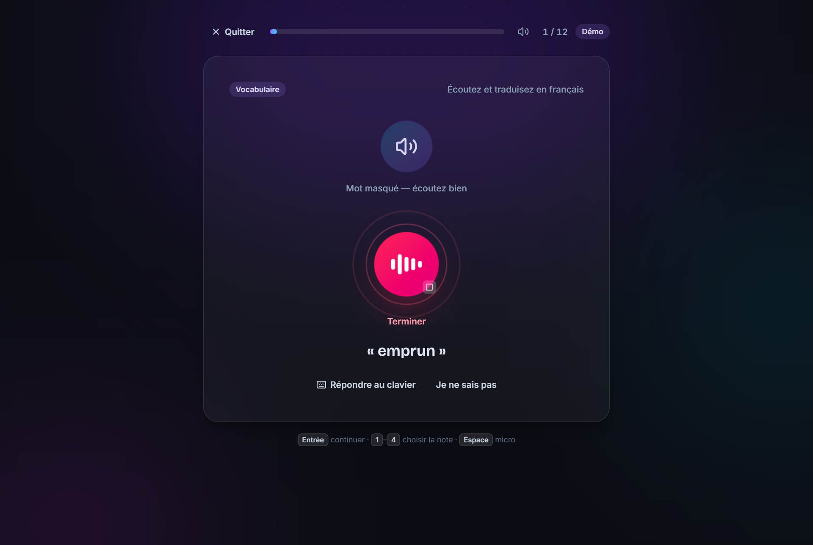
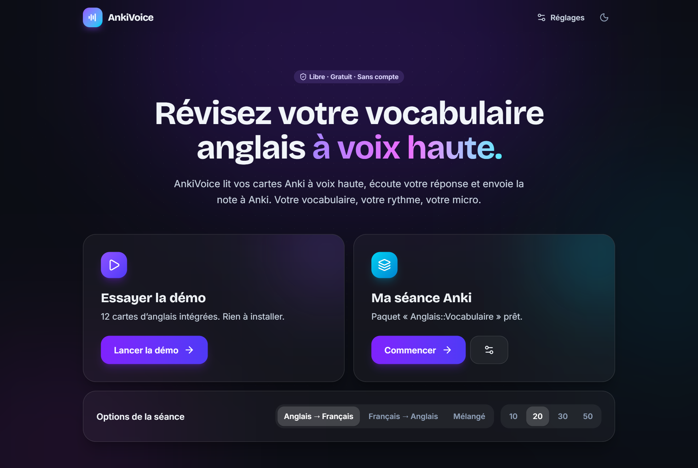
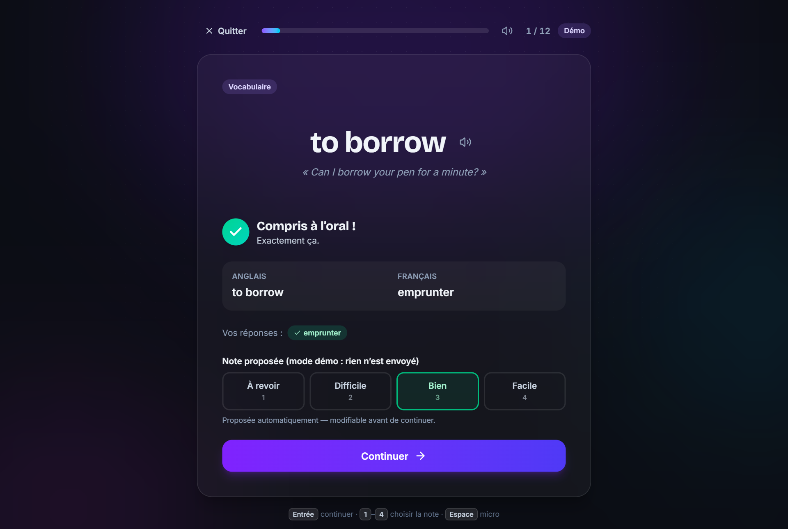
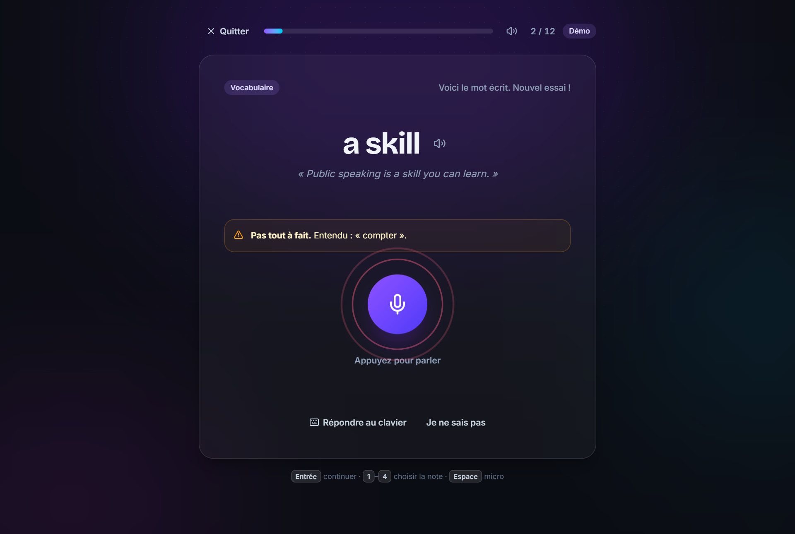
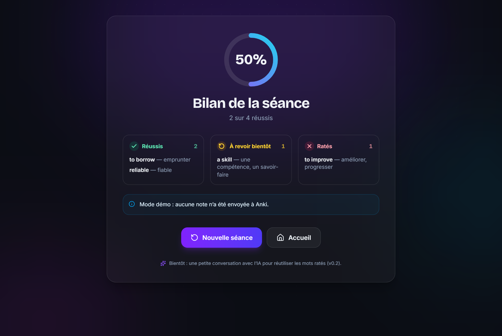
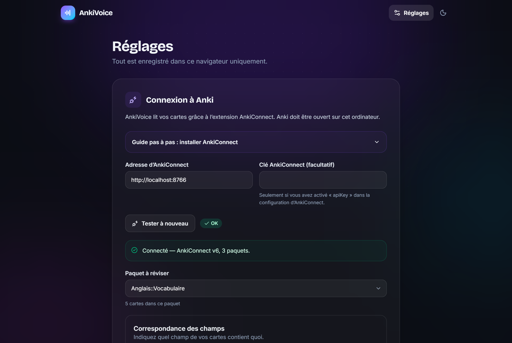
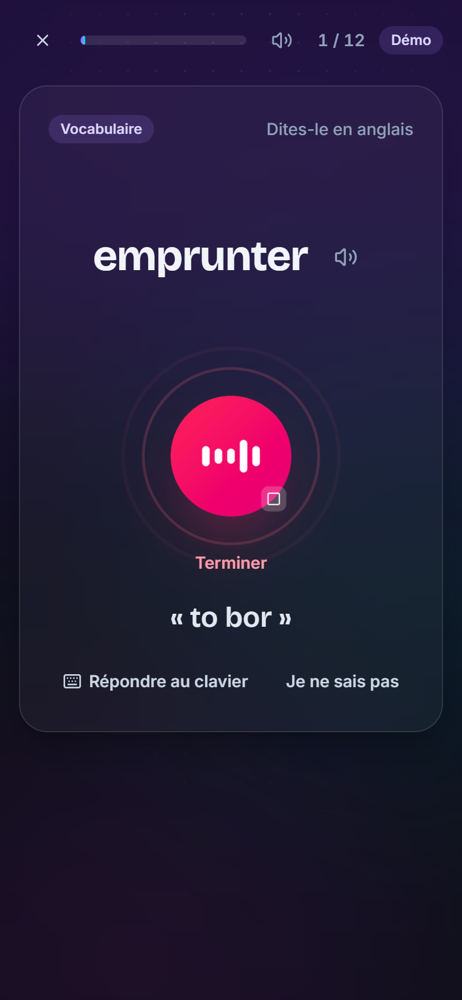

<div align="center">


# AnkiVoice

**Révisez vos cartes Anki à voix haute.** Un quiz vocal libre et gratuit qui lit vos propres cartes Anki,
écoute votre réponse et renvoie la note à Anki.

[Essayer la démo](#essayer) · [Installer AnkiConnect](#brancher-votre-anki-pas-à-pas) · [Vie privée](#vie-privée) · [Limites](#limites-honnêtes) · [Feuille de route](#feuille-de-route) · [🇬🇧 English](README.md)



</div>

## Pourquoi

Beaucoup de collèges et lycées manquent de professeurs d'anglais, et les élèves ont rarement l'occasion de *prononcer* les mots qu'ils révisent.
AnkiVoice transforme les cartes qu'un élève tient déjà dans [Anki](https://apps.ankiweb.net) en un court exercice oral :

1. **Écoutez** — l'app prononce le mot anglais (le mot reste caché).
2. **Répondez à voix haute** en français (ou au clavier). Raté ? Le mot s'affiche par écrit et vous retentez.
3. **Progressez** — la note part directement dans Anki, qui continue de gérer la répétition espacée.

Ça marche aussi dans l'autre sens : le mot français s'affiche, vous le dites en anglais, et vous voyez ce que la reconnaissance vocale a compris.

### Quelle différence avec Duolingo Max, Speak ou Praktika ?

|                      | AnkiVoice                                           | Applis de tuteur vocal          |
| -------------------- | --------------------------------------------------- | ------------------------------- |
| Prix                 | Gratuit, logiciel libre (MIT)                       | Abonnement                      |
| Vocabulaire          | **Vos** cartes Anki, les listes de votre classe     | Le programme de l'appli         |
| Répétition espacée   | Celle d'Anki, intacte                               | Propriétaire                    |
| Compte / pistage     | Aucun, aucune statistique                           | Compte obligatoire              |
| IA                   | Facultative : votre clé, ou un modèle local gratuit | Intégrée, payante               |

AnkiVoice est un outil d'entraînement. **Il ne remplace pas un professeur.**

## Captures

| Accueil | Bonne réponse | Deuxième essai (mot affiché) |
| --- | --- | --- |
|  |  |  |

| Bilan | Réglages | Téléphone |
| --- | --- | --- |
|  |  |  |

## Essayer

Le **mode démo** ne demande aucune installation : ouvrez le site et cliquez sur *Lancer la démo*. Il utilise 12 cartes d'anglais
intégrées (rédigées pour le projet, sous licence MIT) et ne contacte jamais Anki.

À utiliser de préférence dans **Chrome ou Edge** sur ordinateur (reconnaissance vocale et bonnes voix anglaises).

## Brancher votre Anki, pas à pas

AnkiVoice lit vos cartes grâce à l'extension gratuite **AnkiConnect**. Anki doit être ouvert sur le même ordinateur.

1. **Installez Anki** (gratuit) depuis <https://apps.ankiweb.net> et ouvrez-le.
2. **Installez AnkiConnect** : dans Anki, *Outils → Extensions → Obtenir des extensions…*, collez le code **`2055492159`**, validez, puis **redémarrez Anki**.
3. **Autorisez la page AnkiVoice.** Le plus simple : dans AnkiVoice, cliquez sur *Se connecter à Anki* — Anki affiche une fenêtre
   demandant d'autoriser le site ; répondez **Oui** et AnkiConnect s'en souvient. Pour le faire à la main :
   *Outils → Extensions →* sélectionnez *AnkiConnect* *→ Configuration*, et ajoutez l'adresse de la page (affichée dans les réglages d'AnkiVoice) à `webCorsOriginList` :

   ```json
   "webCorsOriginList": [
       "http://localhost",
       "https://VOTRE-PSEUDO-GITHUB.github.io"
   ]
   ```

   Validez et redémarrez Anki. Si vous lancez AnkiVoice sur votre ordinateur, l'adresse est `http://localhost:5173`.
4. Dans AnkiVoice, ouvrez **Réglages → Se connecter à Anki**. Chrome peut demander d'*autoriser l'accès aux appareils du réseau local* : acceptez, c'est ce qui permet à la page de joindre Anki sur votre ordinateur.
5. **Choisissez votre paquet** et indiquez quel champ contient l'anglais, le français, une phrase d'exemple (facultatif) et le type
   (*vocabulaire / grammaire / conjugaison*, facultatif). AnkiVoice devine les noms courants comme `Front`/`Back` et affiche un aperçu.
6. Sur l'accueil, cliquez sur **Commencer**. Seules les cartes **dues** sont proposées (plus quelques nouvelles si vous le souhaitez).

### Comment les notes sont envoyées à Anki

| Ce qui s'est passé                                                        | Note envoyée          |
| ------------------------------------------------------------------------- | --------------------- |
| Compris à l'oral (anglais → français) / trouvé sans indice (français → anglais) | **Bien (3)**    |
| Trouvé seulement une fois le mot écrit / avec l'indice                    | **Difficile (2)**     |
| Raté deux fois ou « Je ne sais pas »                                      | **À revoir (1)**      |

Vous pouvez changer la note (y compris **Facile (4)**) avant de continuer. Elle est envoyée par l'action `answerCards` d'AnkiConnect,
exactement comme si vous aviez cliqué dans Anki : **AnkiVoice ne réimplémente jamais l'algorithme de répétition.**

## Le correcteur IA (facultatif)

Sans IA, AnkiVoice compare votre réponse à la carte en ignorant les articles, les accents, les majuscules et une petite faute de frappe,
et accepte toutes les variantes écrites sur la carte (`emprunter, se faire prêter`). Avec une IA, il accepte aussi les synonymes et les
différences d'accord, et explique l'erreur en une phrase. Une réponse exacte n'appelle jamais l'IA : le coût reste minime.

Une carte liste rarement toutes les traductions possibles. Quel que soit le correcteur, **vous avez le dernier mot** :

- **« J'avais juste »** — si un synonyme correct est refusé, un clic le compte comme bon
  (Bien si c'était votre première réponse, Difficile si c'était la deuxième).
- **« Ajouter à la carte Anki »** — dans une vraie séance, AnkiVoice peut ensuite ajouter votre réponse à la carte
  (`emprunter` → `emprunter, se faire prêter`, par l'action `updateNoteFields` d'AnkiConnect). La prochaine fois, elle sera acceptée même sans IA.
  Rien n'est jamais écrit dans vos cartes sans ce clic.

| Fournisseur | Coût | Mise en place |
| --- | --- | --- |
| **Sans IA** | Gratuit | Rien à faire |
| **Ollama** (local) | Gratuit | Installez [Ollama](https://ollama.com), puis `ollama pull llama3.2`. Pour la version en ligne, autorisez le site : `OLLAMA_ORIGINS=https://VOTRE-PSEUDO-GITHUB.github.io ollama serve` |
| **Claude** (Anthropic) | Votre clé API | Collez une clé créée sur <https://console.anthropic.com>. Modèle de correction : `claude-haiku-5-5` (rapide et peu coûteux). |
| **Compatible OpenAI** | Votre clé API | Adresse + modèle + clé (OpenAI, Mistral, Groq, OpenRouter, LM Studio…) |

Les élèves n'ont jamais à payer : « Sans IA » et Ollama sont gratuits.

## Vie privée

- Aucun compte, aucun serveur, aucune statistique, aucun cookie. AnkiVoice est un site statique.
- Les réglages (y compris une éventuelle clé API) sont enregistrés **uniquement dans votre navigateur** (`localStorage`).
- Vos cartes vont à **votre propre Anki** (sur votre ordinateur) et, si vous en choisissez un, au **fournisseur d'IA choisi** — nulle part ailleurs.
- Les polices sont incluses dans l'application (aucun appel à Google Fonts).
- ⚠️ **La reconnaissance vocale est faite par le navigateur** : dans Chrome et Edge, l'audio est envoyé aux serveurs de Google ou Microsoft pour être transcrit. Si cela vous gêne, répondez au clavier.

## Limites honnêtes

- **Elle ne note pas votre prononciation.** La reconnaissance vocale du navigateur choisit le *mot le plus plausible* : une
  prononciation un peu fausse est souvent « corrigée » sans le dire. Un vrai retour phonétique est prévu en v0.3.
- **Les mots isolés sont difficiles à transcrire**, même dans votre langue : le navigateur n'a pas de phrase pour deviner et choisit souvent
  le mauvais homophone (« amélioré » pour « améliorer », « en prunté » pour « emprunter »). AnkiVoice compare les réponses françaises *au son*,
  donc ces cas comptent comme justes ; il affiche les autres hypothèses entendues ; et **« Ce n'est pas ce que j'ai dit »** efface une réponse
  mal entendue et relance le micro, sans vous coûter d'essai.
- **La reconnaissance vocale** ne fonctionne que dans Chrome, Edge et Safari. Sous Firefox, on répond au clavier.
- **Les voix** : l'anglais est toujours lu avec une voix anglaise. Si votre ordinateur n'en a aucune (fréquent sur un Windows français),
  AnkiVoice affiche le mot écrit au lieu de le lire avec l'accent français. Pour en ajouter une sous Windows :
  *Paramètres → Heure et langue → Voix → Ajouter des voix → Anglais (États-Unis)*, puis redémarrez le navigateur — ou utilisez simplement
  Chrome ou Edge, qui ont leurs propres voix anglaises. Choisissez votre voix préférée dans *Réglages → Voix*.
- **La version en ligne qui parle à Anki** suppose que le navigateur autorise une page HTTPS à appeler `http://localhost`. Chrome et Edge
  le font (après la demande « réseau local ») ; Safari peut le bloquer — utilisez Chrome/Edge ou lancez AnkiVoice en local.
- **Les nouvelles cartes** ajoutées par AnkiVoice ne suivent pas la limite quotidienne d'Anki ; un plafond par séance est réglable.
- L'IA peut se tromper. Vous avez toujours le dernier mot sur la note.

## Lancer AnkiVoice sur votre ordinateur

Il faut [Node.js](https://nodejs.org) 20.19 ou plus récent.

```bash
npm install
npm run dev
```

Puis ouvrez <http://localhost:5173>. Autres commandes :

```bash
npm test            # tests unitaires (Vitest)
npm run build       # version de production dans dist/
npm run mock:anki   # un faux AnkiConnect sur le port 8765, pour développer sans Anki (pas pendant qu'Anki est ouvert)
npm run screenshots # régénère les captures du README (serveur de dev + `PORT=8766 npm run mock:anki` lancés)
```

### Publier sur GitHub Pages

Le workflow `.github/workflows/ci.yml` lance les tests, construit et déploie à chaque push sur `main`.
Sur GitHub, dans le dépôt : *Settings → Pages → Build and deployment → Source : **GitHub Actions***.

## Feuille de route

- **v0.1** (cette version) : quiz oral sur les cartes dues, dans les deux sens, notes envoyées à Anki, correcteur IA (Claude / compatible OpenAI / Ollama / sans IA), mode démo.
- **v0.2** : une conversation de fin de séance avec l'IA qui réutilise les mots ratés et les règles de grammaire de vos cartes.
- **v0.3** : vrai retour sur la prononciation (par ex. Azure Pronunciation Assessment) ; un paquet de départ gratuit construit uniquement à partir
  de sources libres (listes de fréquence, Wiktionnaire — licence citée) ; interface en anglais.

## Contribuer

Les contributions sont bienvenues — surtout traductions, accessibilité et listes de mots libres. Merci de ne jamais proposer de contenu recopié de manuels.

## Licence

[MIT](LICENSE) © 2026 Lancelot Dallain. Les cartes de démonstration font partie du projet et sont sous la même licence.
